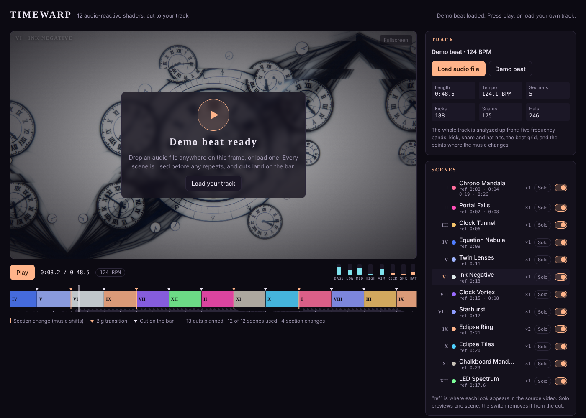
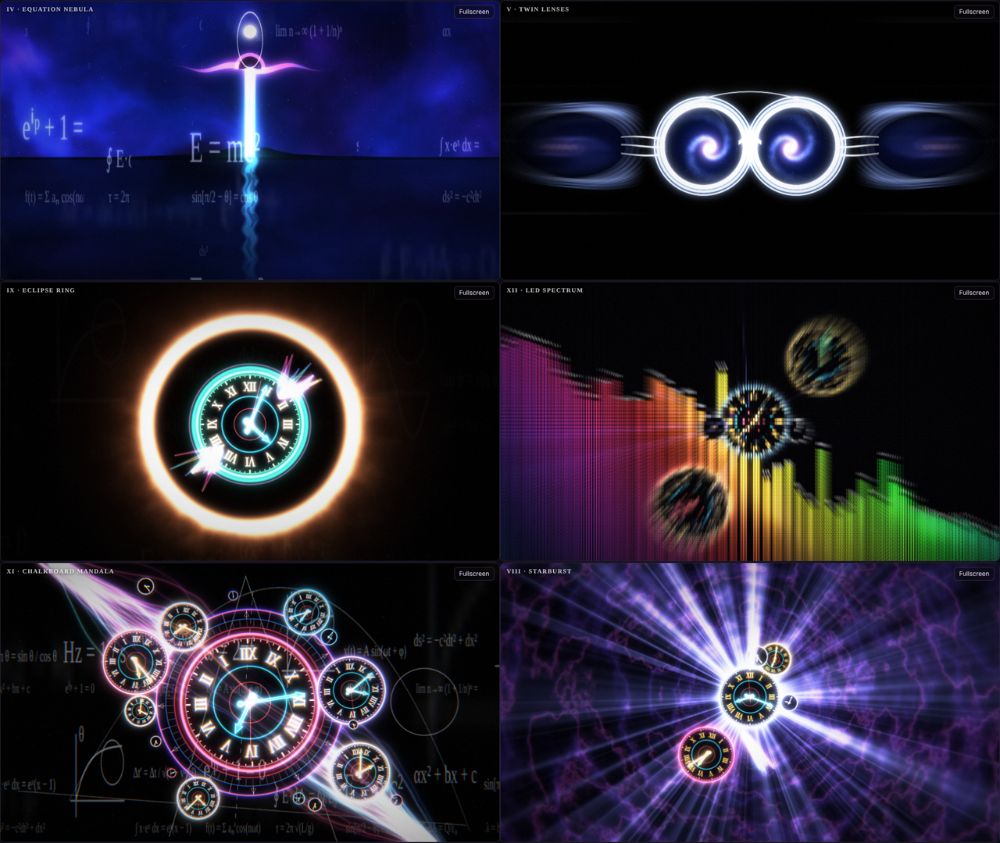
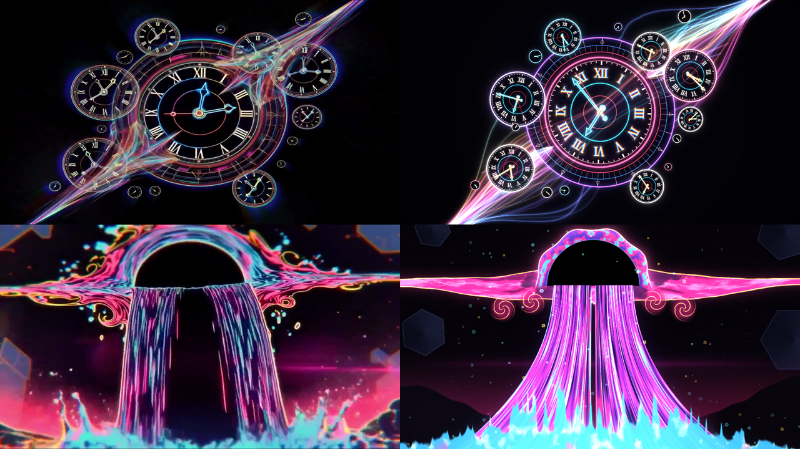
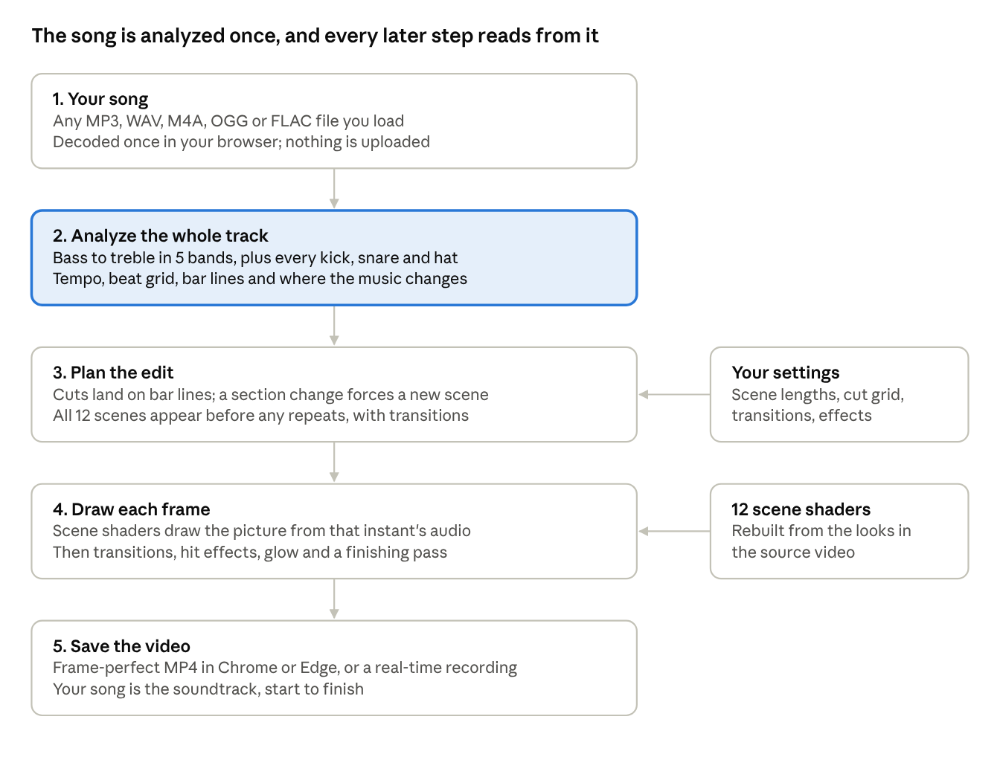

# Timewarp Visualizer

> **Beta.** Timewarp is still being tested across browsers, GPUs and computers. If a render or upload goes wrong, please [open an issue](https://github.com/hughesdo/Timewarp-Visualizer/issues) with your browser, OS and what happened.

**Turn any song into an audio-reactive shader music video.** Load a track, and the page analyzes it, cuts between 12 GLSL scenes on the beat, and exports an MP4 with your song as the soundtrack. Everything runs in one HTML file in your browser. Nothing is uploaded and nothing needs installing.

**[Open the live page](https://hughesdo.github.io/Timewarp-Visualizer/)** · [Download timewarp.html](timewarp.html) · [Read the full guide](docs/GUIDE.md)



The 12 scenes were rebuilt by Claude from a 30-second AI-generated music video. Claude broke the video into its distinct looks, wrote a shader for each, and built the song analysis, auto-editor and exporter around them, from a single prompt. The [guide](docs/GUIDE.md) tells the whole story, including the exact prompt, so you can do the same with your own video.



The source video next to the shader rebuild (left: original frames, right: shaders):



## Credits

- **Teacher:** Don Hughes, [@OneHung on X](https://x.com/OneHung). Wrote the prompt, directed the build with Claude, and shares it here for free.
- **Student and inspiration:** [@StarlitBeRogue on X](https://x.com/StarlitBeRogue). Thank you for sharing your AI video, for asking all the right questions, and for caring enough to want to try this yourself. This repo exists because of that conversation.
- **Built with:** Claude by Anthropic.
- **MP4 writing:** [mp4-muxer](https://github.com/Vanilagy/mp4-muxer) by Vanilagy (MIT), bundled into the page.
- **AAC audio for browsers without their own encoder:** [FFmpeg](https://ffmpeg.org)'s AAC encoder compiled to WebAssembly (LGPL-2.1+), via [@mediabunny/aac-encoder](https://github.com/Vanilagy/mediabunny) by Vanilagy (MPL-2.0). Details in [`vendor/AAC-ENCODER.md`](vendor/AAC-ENCODER.md).

The original AI video, [`source/time.mp4`](source/time.mp4), is by @StarlitBeRogue and is shared here with her permission. Please credit her if you use it.

## Quick start

1. Open the [live page](https://hughesdo.github.io/Timewarp-Visualizer/), or download `timewarp.html` and double-click it. Use Chrome or Edge.
2. Click **Load audio file** (MP3, WAV, M4A, AAC, OGG, FLAC, Opus) or drag a song onto the preview. Nothing plays or renders until a song is loaded.
3. Adjust if you like: scene lengths, cut grid, transition style, hit effects, reactivity, output size.
4. Click **Render MP4 (frame-perfect)**, then **Save video**. The file is ready to post to X as is.

## What's inside

| Path | What it is | Do you need it? |
| --- | --- | --- |
| `timewarp.html` | The whole app in one file, about 890 KB. Shaders, analysis, editor, exporter and a built-in AAC encoder are all inside it. | **Yes. This is the app.** |
| `index.html` | An identical copy, so GitHub Pages serves the app at the repo's address. | No |
| `docs/GUIDE.md` | The full guide: the starting prompt, every step Claude took, the scene breakdown, and how to do it with your own video. Written for beginners. | Recommended reading |
| `docs/AI-Video-to-Shader-Music-Video-Guide.docx` | The same guide as a Word file. | Optional |
| `shaders/` | The 18 GLSL source files, one per scene plus shared libraries and the effect passes, with a README of the inputs. | **No.** They're already built into `timewarp.html`. They're here for learning and remixing. |
| `source/time.mp4` | The original 30-second AI video by @StarlitBeRogue that the scenes were built from. Shared with her permission. | No, but it's fun to compare |
| `src/`, `build.mjs`, `vendor/` | The page's JavaScript and HTML template, the bundled libraries (mp4-muxer and the AAC encoder), and the script that bundles everything into `timewarp.html`. | Only if you want to change the code |

## The 12 scenes

| # | Scene | What it looks like |
| --- | --- | --- |
| I | Chrono Mandala | Ornate Roman-numeral clock, 16 satellite clocks, holographic filament streak |
| II | Portal Falls | Black dome portal with neon pink and cyan waterfall curtains and a cyan splash |
| III | Clock Tunnel | Flying through a tunnel lined with clocks, warp-speed lines |
| IV | Equation Nebula | Blue nebula, chalk formulas writing themselves, a distant waterfall over a lake |
| V | Twin Lenses | Chrome lenses holding spinning galaxies, mirror-smear echoes |
| VI | Ink Negative | The mandala as black ink on white paper, with slice glitches |
| VII | Clock Vortex | Indigo spiral vortex with clocks spiraling inward and crystal shards |
| VIII | Starburst | Radial light rays from a cluster of small clocks |
| IX | Eclipse Ring | Glowing peach corona ring around a clock |
| X | Eclipse Tiles | Kaleidoscope columns of eclipse clocks |
| XI | Chalkboard Mandala | The mandala over a blackboard of formulas, with color split |
| XII | LED Spectrum | Dot-matrix LED screen with a live 48-bar spectrum analyzer |

Plus 8 transitions (flash, lens flare, zoom blur, light-bar wipe, LED pixel dissolve, glitch slices, curved-screen squeeze, vertical smear) and 12 hit effects that fire on kicks, snares and hi-hats.

## How it works



- **Listening:** the whole song is analyzed once, 100 times a second: five frequency bands, every kick, snare and hi-hat, the tempo, bar lines, and where the song changes section.
- **Editing:** section changes force a new scene with a big transition. Otherwise scenes change on bar lines after random lengths. Every scene appears before any repeats.
- **Drawing:** each frame runs the scene shaders with that instant's audio values, then transitions, hit effects and glow.
- **Saving:** frame-perfect export renders every frame offline with WebCodecs and writes an MP4 with H.264 video and AAC audio. Real-time recording captures the screen and sound as the song plays.

Because the analysis is done up front, the preview and the export always match.

## Posting to X

Render MP4 writes the format X asks for: H.264 video and AAC-LC audio at 44.1 or 48 kHz, 192 kbps stereo, with the index at the front of the file. The Export card shows what your browser will write before you render, with an estimate of the file size, and it flags when a video is past a free X account's limits:

- **Free accounts:** up to 2 minutes 20 seconds and 512 MB, played back at 720p.
- **X Premium:** up to 4 hours and 16 GB on the web, with 1080p playback and 4K uploads.

X re-encodes every upload, so 16 Mbps at 1080p is plenty for posting. Use Render MP4 rather than real-time recording for anything you post. X changes its limits from time to time; the current rules are on [help.x.com](https://help.x.com/en/using-x/x-videos).

## Make one from your own AI video

The [guide](docs/GUIDE.md#doing-it-yourself-with-your-own-video) has two copy-and-paste prompts:

- **Path A:** give Claude your video and build everything from scratch, the way this one was made.
- **Path B:** give Claude your video plus `timewarp.html`, and ask it to swap in new scenes from your video while keeping the engine. Faster and safer.

## Changing the code

Edit files in `shaders/` or `src/`, then rebuild the single file:

```bash
node build.mjs
```

This writes `dist/timewarp-standalone.html`. Copy it over `timewarp.html` and `index.html`. No packages to install; Node 18 or newer is enough.

## Requirements and limits

- Chrome or Edge for frame-perfect MP4. In other browsers, the Export card tells you what they can write before you render, and real-time recording works as a fallback.
- A reasonably modern GPU. On older laptops, set Preview quality to Draft. Exports are never affected by preview stutter.
- Audio is always AAC: the browser's own encoder where it has one (Chrome and Edge on Windows and Mac), otherwise the encoder built into the page (Chrome on Linux, Firefox). Where H.264 video isn't available, the MP4 falls back to VP9, which plays in VLC and browsers but not on X or QuickTime. The Export card warns you first.
- Sound sits about 21 ms behind the picture, the start-up delay every AAC encoder adds. That's about one frame at 60 fps, well under what anyone can see.
- The handwritten chalk formulas use the Google font Caveat and fall back to a serif font offline.
- Tested end to end in a headless browser with software rendering, not yet on a wide range of real GPUs. Issues and reports are welcome.

## License

MIT. See [LICENSE](LICENSE). The bundled AAC encoder keeps its own licenses (LGPL-2.1+ for FFmpeg, MPL-2.0 for the bridge); see [`vendor/AAC-ENCODER.md`](vendor/AAC-ENCODER.md).
